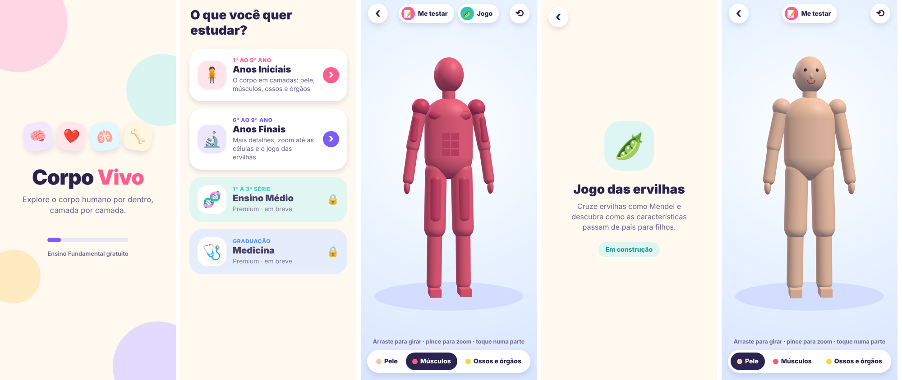

# Corpo Vivo

App de estudo do corpo humano, do Ensino Fundamental à Medicina. Corpo 3D interativo em camadas, toque numa parte e veja o que ela faz.



## Status

Protótipo da etapa 1:

- [x] Tela inicial
- [x] Escolha do ano (Fundamental: Anos Iniciais e Anos Finais; Médio e Medicina bloqueados)
- [x] Corpo 3D com três camadas: pele, músculos, ossos e órgãos
- [x] Toque numa parte: destaca o sistema e abre o cartão com a explicação
- [x] Texto diferente para Anos Iniciais (simples) e Anos Finais (mais detalhe + "Saiba mais")
- [ ] Zoom até a célula (Anos Finais)
- [x] Me testar: corpo inteiro (10, 25 ou 50) ou por sistema, confirmação da resposta, explicação, resultado e revisão que abre o cartão da parte do corpo (`src/data/questoes.ts`, 122 questões)
- [ ] Anotações
- [ ] Mini-game das ervilhas de Mendel
- [ ] Trocar o modelo estilizado pelo modelo anatômico do Z-Anatomy

## Rodar no celular

Precisa de Node.js 20+ no computador e do app **Expo Go** no celular (Android ou iOS).

```bash
npm install
npx expo start
```

Leia o QR code com o Expo Go (Android) ou com a câmera (iPhone). Computador e celular precisam estar na mesma rede Wi-Fi. Se a rede bloquear, use `npx expo start --tunnel`.

O 3D carrega a biblioteca three.js pela internet, então o celular precisa estar online.

Para ver no navegador: `npx expo start --web`.

## Ranking mundial (opcional)

Os jogos dão pontos (acertos, agilidade e desconto por erro) e salvam as partidas no celular.
Para o ranking mundial:

1. Crie um projeto no [Supabase](https://supabase.com) e rode `supabase/ranking.sql` no SQL Editor.
2. Copie `.env.example` para `.env.local` e preencha a URL e a chave publishable (ou anon).
3. Reinicie o `npx expo start`.

Sem isso o app funciona normalmente, com ranking só das partidas do próprio celular.
Os apelidos são gerados pelo app (sem nome digitado), porque o público inclui crianças.

## Estrutura

```
src/
  app/               telas (Expo Router)
    index.tsx        tela inicial
    anos.tsx         escolha do ano
    corpo.tsx        corpo 3D + camadas + cartão
  components/
    BodyView.tsx     cena 3D numa WebView (celular)
    BodyView.web.tsx cena 3D num iframe (web)
    InfoCard.tsx     cartão de informação
  three/
    bodyScene.ts     cena three.js (modelo, camadas, toque, animações)
  data/
    sistemas.ts      textos dos sistemas e órgãos do Fundamental
  theme.ts           cores
```

Para adicionar ou corrigir conteúdo, edite `src/data/sistemas.ts`. Cada peça 3D tem um id (ex.: `coracao`) que precisa existir em `ORGAOS`.

## Licença e créditos

- Código: MIT (ver `LICENSE`).
- Conteúdo do Ensino Fundamental: aberto, sob a mesma licença do código.
- O modelo atual é estilizado e foi feito do zero com formas do three.js.
- Quando o modelo anatômico entrar, ele virá do [Z-Anatomy](https://github.com/LluisV/Z-Anatomy) (CC BY-SA 4.0), baseado no BodyParts3D (CC BY-SA 2.1 Japan, Database Center for Life Science). Os arquivos 3D adaptados ficarão sob CC BY-SA 4.0, com os créditos completos aqui.
- Conteúdo do Ensino Médio e da Medicina não faz parte deste repositório.
